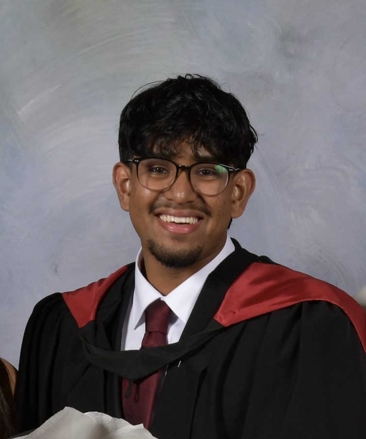

# About Me

 

  
  Hi, I’m <strong>Sithma Gunawardena!</strong>
 

 
I’m a Biomedical Engineering (Honours) graduate from the University of Sydney, specialising in nanoscale biotechnology. I currently work as a Loan Kit Technician at LifeHealthcare, where I support the inspection, preparation and traceability of surgical instruments and implant systems. I’m interested in engineering roles that combine hands-on technical work with problem-solving, particularly medical device servicing, troubleshooting, prototype development, and verification and validation.

## Industry Experience

At LifeHealthcare, I work with orthopaedic, spinal, cervical, reconstructive surgery and Motiva implant loan inventory. My role involves inspecting returned instruments, checking kit completeness, identifying damaged or missing equipment, and coordinating replenishment, repair and replacement. I use SAP/MyM and Zebra scanning systems to maintain accurate stock records and product traceability, helping ensure equipment is available for scheduled procedures.
 
 
Through LifeHealthcare’s integration with CAB Medical, I’ve also supported medical instrument and implant counts and helped service a powered surgical device system used for bunion correction. My work includes checking torque instruments against specified requirements in N·m and flagging deviations for further review. These experiences have strengthened my attention to detail and my interest in the performance, reliability and maintenance of medical equipment.
 
 
As a volunteer Workshop Assistant with the Cerebral Palsy Alliance, I gained practical experience in fabrication, basic wiring, soldering and electrical fault-finding. Working alongside rehabilitation engineers, occupational therapists and physiotherapists gave me insight into how technical decisions affect the everyday usability of assistive devices.

## Engineering Projects and Research

Throughout my degree, I led and contributed to projects across assistive technology, biomedical instrumentation and diagnostics.
 
 
I led a customised seating solution project for people with cerebral palsy in collaboration with Jacaranda Flame Consulting and the Cerebral Palsy Alliance. This involved researching foams, hydrogels and TPU lattice structures, developing CAD designs, and planning prototyping and testing. Our design report addressed manufacturing, cost, timing, sustainability and risk.
 
 
I also led the design iterations for a custom lower-limb orthotic for a child with SATB2 syndrome, applying human-centred design, measurement and fitting considerations, and engineering documentation to develop a solution around the individual’s needs.
 
 
In biomedical instrumentation, I helped develop a PPG-based pulse oximeter using Arduino and Python, incorporating signal processing and a graphical interface to display heart rate and oxygen saturation. The project achieved the top-ranked system demonstration. I also worked on a machine learning model for heart attack risk prediction, using feature engineering and classification performance evaluation.
 
 
My honours research focused on an electrochemical biosensor for detecting myeloperoxidase (MPO), a marker associated with inflammation. This involved experimental assay development, electrochemical testing, calibration and data analysis using MATLAB and OriginPro. It strengthened my ability to learn unfamiliar equipment and software, troubleshoot experimental issues, and interpret results critically.

## Technical Skills and Communication

My experience spans CAD and prototyping, workshop fabrication, biomedical sensors, Arduino-based systems, and data analysis using Python and MATLAB. I enjoy understanding how a device works, investigating why it may not perform as expected, and documenting findings clearly.
 
 
I’m also comfortable presenting technical work to academic and mixed technical audiences. My presentations have covered electrochemical biosensing, the influence of mechanical forces on stem cell differentiation, and biomaterial-based approaches to knee osteoarthritis treatment.
 
 

**Check out my projects for more detail on my work!**

---

## Engineering Opportunities
 
I’m seeking entry-level and graduate engineering opportunities where I can contribute my practical skills while continuing to develop my technical experience. My particular interests include:
 

- **Field service and technical support:** equipment servicing, fault-finding, maintenance and troubleshooting.
- **Verification and validation:** device testing, checking performance against requirements, investigating failures and documenting results.
- **Medical device development:** hands-on prototyping, design iterations and performance evaluation.
- **Biomedical instrumentation and electronics:** sensors, circuits, data acquisition, calibration and hardware integration.
- **Embedded systems:** microcontroller prototyping, interfacing and testing.
- **Signal processing and data analysis:** Python, MATLAB, experimental analysis and visualisation.
- **Design and fabrication:** CAD, 3D printing, workshop fabrication and assistive technology.
- **Quality and engineering documentation:** traceability, risk assessment and clear technical reporting.

I’m open to opportunities across biomedical engineering and the wider engineering sector, and I’d welcome the chance to connect with teams working on practical engineering challenges.